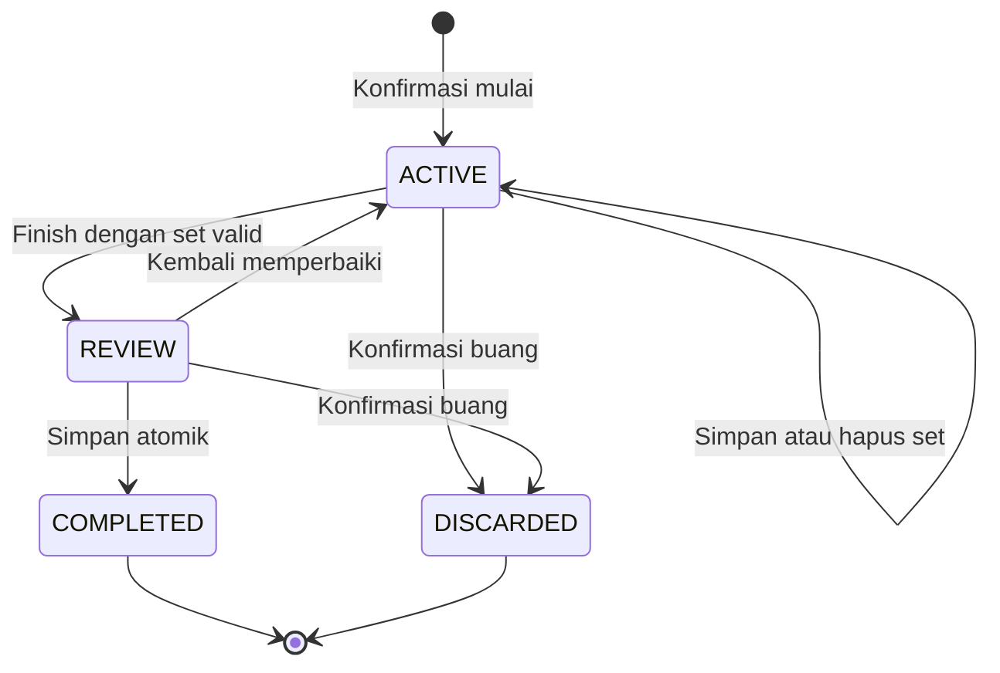

# ATHRA Product Requirements Document

Versi 1.0, 14 November 2026.

Dokumen ini adalah spesifikasi implementasi aplikasi Android ATHRA untuk proyek akhir PAPB. Pembaca utamanya adalah AI coding agent yang membangun, menjalankan, menguji, dan menyiapkan aplikasi untuk demonstrasi end to end.

## 1. Acuan dan prioritas keputusan

Urutan acuan apabila ditemukan perbedaan adalah sebagai berikut.

1. Instruksi langsung pemilik proyek, termasuk penetapan tab **GPT's workspace** sebagai source of truth.
2. Ketentuan wajib tugas pada **PAPB13-Project Akhir.pdf**.
3. Kebutuhan produk dan aturan bisnis pada tab **GPT's workspace** di laporan proyek.
4. Keputusan implementasi tambahan yang dinyatakan secara eksplisit dalam PRD ini.
5. Figma sebagai acuan visual. Sesuaikan elemen dan alurnya dengan kebutuhan fungsional di atas.

Sumber yang digunakan.

| Sumber | Lokasi | Penggunaan |
| --- | --- | --- |
| Laporan proyek, tab GPT's workspace | https://docs.google.com/document/d/1krPHdOr-vaD7U02k5oLk7zMJ4t1Uof1qhIFGNhe76Sc/edit?tab=t.4nddw5tr75vg | Kebutuhan produk, batas UAP, logika, penyimpanan, pembagian fungsi |
| Figma ATHRA UI UX | https://www.figma.com/design/LajDqaCMI6TrEvtqHEPKF6/ATHRA-UI-UX?node-id=29-2 | Tampilan ATHRA Minimal Redesign dan komponen pendukung |
| PAPB13-Project Akhir.pdf | PDF ketentuan yang disertakan bersama konteks proyek | Syarat native Android, jumlah fungsi, teori, presentasi, dan kesesuaian laporan |

Tab laporan lain dan halaman Figma lama hanya memberikan konteks. Jangan mengambil fitur tambahan dari sana apabila tidak tercakup dalam PRD. Contoh SmartGudang pada template laporan bukan requirement ATHRA.

Label **[S]** berarti kebutuhan dari source of truth. Label **[K]** berarti keputusan tambahan dalam PRD untuk menutup detail yang belum ditentukan. Keputusan [K] menjadi default implementasi, bukan klaim bahwa hal tersebut sudah disepakati dalam laporan sumber.

## 2. Ringkasan produk

ATHRA membantu pengguna latihan beban mencatat sesi dan memahami perkembangan latihan dari data. Pengguna memasukkan gerakan, set, repetisi, dan beban secara manual. Aplikasi menghitung durasi dan volume, mengolah statistik, mengenali rekor beban, serta menampilkan latihan terakhir sebagai pembanding.

Masalah yang diselesaikan adalah catatan latihan yang tersebar, perhitungan manual, kesulitan menemukan hasil gerakan terakhir, dan kesulitan mengetahui perkembangan beban. Solusinya adalah satu alur pencatatan yang terhubung dengan empat fungsi pengolahan data.

**Hasil akhir yang dituju:** pengguna dapat membuat akun, memulai workout, memilih exercise, mencatat dan memperbaiki set, melihat pembanding latihan, meninjau hasil dan personal record, menyimpan sesi, lalu melihat riwayat dan analytics yang konsisten. Seluruh alur harus berfungsi menggunakan data persisten.

Pengguna utama adalah individu yang melakukan latihan beban. Satu instalasi dapat digunakan bergantian oleh beberapa akun, tetapi hanya satu akun aktif pada satu waktu. Aplikasi tidak memiliki peran admin atau pelatih.

## 3. Sasaran dan batas proyek

### 3.1 Sasaran wajib

- [S] Native Android menggunakan Kotlin dan Jetpack Compose.
- [S] Empat fungsi utama untuk empat anggota kelompok, masing-masing menghasilkan pengolahan data di luar CRUD dasar.
- [S] Autentikasi sebelum mengakses data pribadi.
- [S] Pencatatan yang tetap konsisten saat berpindah layar dan rotasi perangkat.
- [S] Penyimpanan lokal, pemisahan riwayat per akun, dan satuan yang konsisten.
- [S] Minimal tiga teori perkuliahan dibuktikan dalam implementasi.
- [S] Implementasi, demo, dan laporan akhir menjelaskan perilaku yang sama.

### 3.2 Cakupan UAP

| Area | Termasuk |
| --- | --- |
| Akun | Sign In, Sign Up, mempertahankan sesi autentikasi, Sign Out |
| Workout | Start Workout, Quick Start, katalog dan filter, detail exercise, tambah atau ubah atau hapus set, timer, volume, Summary, simpan sesi |
| Analisis | Analytics 7/30/90 hari, jumlah sesi, set, repetisi, volume, grafik volume, exercise favorit |
| Personal Record | Empat status per exercise dan snapshot hasil ketika sesi disimpan |
| Referensi | Riwayat exercise terakhir, perbandingan set berpasangan, selisih jumlah set dan volume |
| Data pribadi | Profile, Edit Profile untuk nama, Preferences kg/lb, Workout History, rincian sesi tersimpan |
| Keandalan | Validasi, loading/error/empty state, pencegahan simpan ganda, pemulihan sesi valid yang belum selesai |

### 3.3 Di luar cakupan

Fitness Goals, Notifications, pengingat jadwal, rest timer dan alarm, sinkronisasi workout antarperangkat, backend kustom, Firestore untuk workout, sensor, IoT, wearable, pengukuran gerakan otomatis, AI coach, rekomendasi kenaikan beban otomatis, estimasi 1RM, RPE, intensity score, unggah foto, ekspor latihan, custom exercise, routine builder, langganan, social sharing, serta penghapusan akun.

[K] Forgot Password dan pergantian tema tidak termasuk versi ini. Tautan Forgot Password, Appearance, Help, Privacy management, dan menu lain yang belum diimplementasikan tidak ditampilkan sebagai kontrol aktif. Informasi singkat bahwa workout tersimpan lokal boleh ditampilkan sebagai teks.

[K] Sesi yang sudah selesai bersifat read-only. Edit dan hapus yang wajib pada versi ini adalah set dalam sesi aktif. Fitur edit/hapus riwayat selesai memerlukan aturan ulang PR dan tidak termasuk cakupan.

API dan sensor tidak perlu ditambahkan hanya untuk melengkapi daftar materi. Minimal tiga teori dapat dipenuhi melalui Activity, Navigation, Coroutine, State/ViewModel, dan Room.

## 4. Pemetaan ketentuan akademik

| Ketentuan | Implementasi | Bukti yang harus tersedia |
| --- | --- | --- |
| Native Kotlin/Java | Kotlin, Activity, Jetpack Compose | Proyek Android yang dapat dibangun dan APK yang dapat dipasang |
| Fungsi minimal sebanyak anggota | Empat fungsi utama pada bagian 8 sampai 11 | Demo input, proses, dan output untuk setiap fungsi |
| Background, problem, solution | Penjelasan pada bagian 2 | README dan bahan laporan yang sesuai aplikasi |
| Android Activity | MainActivity sebagai host aplikasi | Entry point dan lifecycle aplikasi |
| Android Navigation | Auth graph, main graph, workout graph | Perpindahan layar dan back stack yang benar |
| Background Task/Coroutine | Akses Room dan pengolahan data di luar main thread | Implementasi repository dan perhitungan, UI tetap responsif |
| State/ViewModel | ViewModel sesi bersama, StateFlow, state hoisting | Uji rotasi dan perpindahan Library/Active/Summary |
| Database | Room untuk sesi, exercise, set, profil | Riwayat bertahan setelah aplikasi dibuka ulang |
| Laporan sesuai implementasi | Penjelasan berdasarkan kode dan hasil uji aktual | Tidak ada fitur fiktif atau screenshot mockup yang diklaim sebagai hasil aplikasi |

Target implementasi membuktikan lima kategori teori di atas. Firebase Authentication tidak dihitung sebagai bukti database workout, karena workout disimpan di Room.

Menurut PDF, presentasi berlangsung pada 17 atau 24 November 2026 dan semua kelompok harus siap pada minggu pertama, 17 November. Siapkan PPT, demo aplikasi, dan draft laporan. Batas presentasi adalah 15 menit presentasi/demo dan 5 menit diskusi. Laporan final dapat dikumpulkan H-1 sebelum UAS PAPB. Jadwal UAS dan giliran kelompok belum diberikan, sehingga jangan mengarang tanggalnya.

## 5. Keputusan implementasi tambahan

Bagian ini mengisi celah spesifikasi agar agent dapat bekerja tanpa menunggu keputusan rutin.

| ID | Keputusan [K] | Alasan |
| --- | --- | --- |
| K01 | Gunakan single Activity, Compose, Material 3, dan Navigation Compose | Sesuai platform serta memudahkan integrasi state |
| K02 | Gunakan Firebase Authentication Email/Password. Sediakan konfigurasi Auth Emulator untuk development dan pengujian | Autentikasi nyata dapat diuji tanpa menyimpan password sendiri |
| K03 | Persist sesi belum selesai ke Room setiap perubahan valid. Maksimal satu sesi belum selesai per akun | Memulihkan latihan tanpa membuat sesi ganda |
| K04 | Durasi dihitung dari waktu mulai ke waktu masuk Summary. Summary membekukan waktu akhir sementara. Kembali ke Active melanjutkan dari waktu mulai asli | Tidak memerlukan fitur pause terpisah |
| K05 | Satu exercise ID hanya memiliki satu kelompok set dalam satu sesi | Urutan set dan pembandingan tidak ambigu |
| K06 | Set yang berhasil disimpan setelah validasi dianggap sudah dicatat/dikerjakan. Tidak ada checkbox completion terpisah | Source menggunakan seluruh set valid sebagai dasar hitung |
| K07 | Sesi yang selesai tidak dapat diedit/dihapus pada versi ini. Detail riwayat memakai mode read-only | Menjaga snapshot PR dan scope UAP |
| K08 | Semua periode dan pengelompokan tanggal memakai zona waktu perangkat. Tanggal sesi ditentukan oleh waktu selesai | Batas periode dan sesi lintas tengah malam konsisten |
| K09 | Gunakan aritmetika desimal untuk beban dan volume, dengan pembulatan hanya saat menampilkan | Menghindari perubahan rekor akibat pembulatan atau konversi berulang |
| K10 | Default satuan akun baru adalah kilogram, default periode analytics 30 hari | Memastikan first run terdefinisi |
| K11 | UI utama menggunakan bahasa Indonesia dengan nama layar/istilah exercise seperti sumber. Tema gelap mengikuti Figma | Konsistensi UI dan pesan validasi |
| K12 | Minimum Android 8.0/API 26. Versi SDK dan dependency lain dipilih kompatibel, diverifikasi, lalu dipin di repository | Batas dukungan konkret tanpa mengarang versi dependency terbaru |
| K13 | Start Workout dan Quick Start sama-sama membuat sesi kosong. Kartu suggested routine pada Figma tidak memuat mesin rekomendasi atau paket latihan | Menghindari penambahan routine builder di luar source |
| K14 | Tambahkan kontrol Buang sesi dengan konfirmasi, serta Lanjutkan sesi ketika draft tersedia | Pengguna dapat menangani sesi yang belum selesai |
| K15 | Grafik analytics menggunakan volume per hari. Hari tanpa sesi memiliki nilai nol apabila periode memiliki data | Definisi grafik dapat diuji dengan pasti |

## 6. Navigasi dan daftar layar

### 6.1 Struktur navigasi

- Auth graph: Sign In, Sign Up.
- Main graph dengan tab Home, Train, Progress, Profile.
- Train membuka Start Workout. Progress membuka Analytics.
- Workout graph: Quick Start, Exercise Library, Exercise Filters, Exercise Details, Active Workout, Summary.
- Layar pendukung: Workout History, Workout Detail, Edit Profile, Preferences.
- [S] Home menjadi tujuan awal setelah autentikasi.
- [S] Active Workout dan Summary tidak menampilkan bottom navigation.
- [K] Bottom navigation hanya muncul pada empat root tab. Halaman turunan memakai app bar dengan Back.
- [K] Login sukses membersihkan auth back stack. Sign Out membersihkan seluruh layar pribadi dari back stack.
- [K] Berpindah tab tidak membuat duplikasi root destination. State tab yang wajar dipertahankan.

### 6.2 Peta interaksi layar

| Layar | Isi wajib | Aksi dan tujuan |
| --- | --- | --- |
| Sign In | Email, password, tombol masuk, tautan daftar, pesan validasi/loading/error | Masuk ke Home atau buka Sign Up |
| Sign Up | Nama, email, password, konfirmasi, tombol daftar, tautan masuk | Daftar lalu Home, atau kembali Sign In |
| Home | Sapaan dari profil, ringkasan minggu ini, sesi terakhir, CTA mulai/lanjut | Start Workout/Active/Summary, History, Workout Detail |
| Start Workout | Penjelasan singkat, Mulai sesi, Quick Start, status draft bila ada | Konfirmasi mulai lalu Library, atau Quick Start |
| Quick Start | Nama sesi opsional, penjelasan pilih exercise | Konfirmasi mulai lalu Library. Jika draft ada, lanjutkan draft |
| Exercise Library | Search nama, filter, daftar katalog, aksi tambah, akses detail | Tambah ke sesi lalu Active, Filters, Details |
| Exercise Filters | Semua dan kelompok otot yang tersedia | Terapkan pilihan lalu kembali ke hasil Library |
| Exercise Details | Nama, kelompok otot, alat, petunjuk statis, riwayat terakhir bila ada | Tambah ke sesi atau kembali ke pemanggil |
| Active Workout | Timer, nama sesi, daftar exercise, set, input, volume, referensi terakhir | Tambah/ubah/hapus set, tambah exercise, buka detail, Finish, buang sesi |
| Summary | Ringkasan, daftar exercise, empat status PR, tombol simpan dan kembali | Simpan atomik lalu Home, atau kembali Active |
| Analytics | Pilihan 7/30/90, sesi/set/repetisi/volume, grafik, favorit | Ganti periode, kembali/tab lain |
| Workout History | Semua sesi selesai akun aktif, terbaru dahulu | Buka Workout Detail |
| Workout Detail | Data sesi selesai, seluruh exercise/set, volume, snapshot PR | Read-only, Back ke asal |
| Profile | Nama, email, Edit Profile, Preferences, History, Sign Out | Navigasi sesuai kontrol, keluar akun |
| Edit Profile | Input nama, email read-only, simpan | Simpan nama lalu Profile |
| Preferences | Pilihan kg/lb, pratinjau, simpan | Simpan preferensi akun lalu kembali |

Exercise Details menyimpan asal navigasi. Back dari detail yang dibuka melalui Library kembali ke Library, sedangkan detail yang dibuka melalui Active kembali ke Active. Jangan mengikuti prototype yang selalu mengarah ke satu layar statis tanpa konteks.

## 7. Akun dan pemisahan data

### 7.1 AUTH-01, Sign Up [S]

Nama, email, password, dan konfirmasi wajib diisi. Nama dan email di-trim, sedangkan password tidak di-trim atau diubah diam-diam. Email harus berformat valid, password minimal enam karakter, dan konfirmasi identik dengan password.

Setelah input valid, kirim pembuatan akun ke Firebase Authentication. Saat loading, nonaktifkan submit ganda. Setelah sukses, buat profil lokal terkait Firebase UID dan buka Home. Jika email sudah terdaftar atau koneksi gagal, tetap di form dengan pesan yang dapat ditindaklanjuti.

[K] Nama awal juga diteruskan sebagai display name Firebase agar tersedia saat profil lokal pertama kali dibuat di perangkat lain. Jika pembuatan akun sukses tetapi penyimpanan nama/profil gagal, tandai autentikasi sudah berhasil dan berikan retry tahap profil. Jangan mengulangi pembuatan akun atau menampilkan seolah-olah akun belum dibuat. Area utama dibuka setelah profil lokal berhasil dipastikan tersedia.

### 7.2 AUTH-02, Sign In [S]

Validasi email dan kolom kosong sebelum request. Login menggunakan email/password Firebase. Password salah atau akun tidak valid menghasilkan pesan umum yang jelas. Kegagalan jaringan menawarkan coba lagi dan mempertahankan input email.

[K] Login sukses memanggil operasi idempoten untuk memastikan profil lokal tersedia, kemudian memuat data berdasarkan UID. Jika Firebase masih memiliki sesi akun yang tersimpan saat cold start, aplikasi dapat membuka data lokal tanpa request login baru. Login/registrasi baru tetap membutuhkan internet, kecuali menggunakan Auth Emulator lokal.

### 7.3 AUTH-03, Sign Out [S]

Keluar akun menghapus state pribadi dari ViewModel, screen cache, dan back stack, lalu membuka Sign In. Tidak boleh ada kilasan nama, statistik, draft, atau riwayat akun lama pada akun berikutnya.

[K] Draft dan riwayat tetap disimpan lokal dengan pemilik UID semula. Sign Out tidak menghapusnya. Saat akun tersebut login kembali, draft dapat dilanjutkan. Selama write sedang berlangsung, tunggu hasilnya sebelum keluar. Tampilkan pemberitahuan bila ada draft yang akan tetap tersimpan.

### 7.4 DATA-01, isolasi akun

Setiap akses sesi, detail, PR, referensi, profil, dan preferensi harus menyertakan UID akun aktif. ID sesi dari route bukan bukti kepemilikan. Repository wajib memeriksa UID dan kepemilikan parent sebelum read/write rincian exercise atau set.

Mutasi menggunakan UID yang ditangkap saat operasi dimulai. Operasi akun A yang terlambat selesai tidak boleh memperbarui state UI akun B. Hentikan subscription lama ketika UID berubah. Katalog exercise boleh digunakan bersama karena tidak memuat data pribadi.

Password dan token autentikasi tidak disimpan oleh aplikasi dalam Room, DataStore, SavedStateHandle, log, atau seed. Pengelolaan sesi autentikasi diserahkan kepada Firebase SDK.

## 8. Fungsi utama 1, Workout Real Time

### 8.1 WORK-01, memulai dan melanjutkan sesi

- [S] Timer baru dimulai setelah konfirmasi mulai, bukan ketika Home/Start Workout hanya dibuka.
- [K] Nama default adalah `Workout` diikuti tanggal dan jam lokal mulai. Quick Start boleh mengubah nama sebelum mulai. Nama kosong setelah trim menggunakan default.
- [K] Buat session ID stabil dan catatan ACTIVE secara atomik dengan slot draft akun. Setelah itu buka Library.
- [K] Bila draft sudah ada, tawarkan Lanjutkan atau Buang sesi. Membuka Start/Quick Start tidak membuat draft kedua.
- [K] Draft REVIEW dilanjutkan ke Summary. Draft ACTIVE dilanjutkan ke Active atau Library jika belum memiliki exercise.
- [K] Setelah restart, pulihkan set valid terakhir dari Room. Teks input yang belum pernah disimpan tidak dijanjikan pulih setelah process death, tetapi dipertahankan saat rotasi.

### 8.2 WORK-02, menambah exercise

Exercise memakai ID katalog tetap. Memilih Tambah membuat satu session exercise dengan urutan stabil. Memilih ID yang sudah ada membuka kelompok set yang sama, tanpa duplikasi.

Pengguna boleh menambahkan exercise lain selama sesi berlangsung. Exercise tanpa set valid tidak masuk ringkasan latihan dan tidak dihitung pada analytics/PR/referensi. Pengguna dapat menghapus exercise dari draft dengan konfirmasi jika sudah berisi set. Penghapusan tersebut menghitung ulang total sesi.

### 8.3 WORK-03, menambah dan mengubah set [S]

Set memuat nomor, repetisi, dan beban dengan satuan yang terlihat. Repetisi harus bilangan bulat lebih dari nol. Beban harus angka nol atau lebih. Kolom kosong, negatif, bukan angka, atau angka di luar kemampuan parsing ditolak. NaN dan infinity bukan input valid.

[K] Parser menerima titik atau koma sebagai satu pemisah desimal dan tidak menerima pemisah ribuan. Tampilkan contoh input agar `20,5` dan `20.5` sama-sama dapat dipahami sebagai 20,5. Pesan untuk repetisi desimal adalah `Repetisi harus berupa bilangan bulat lebih dari nol`.

Input berupa string draft di UI. Tombol Simpan set atau Simpan perubahan memvalidasi dan mengubah record persisten. Sebelum commit berhasil, jangan mengubah nilai set yang sudah sah. Perubahan tidak valid mempertahankan set lama dan total volume lama.

[K] Set yang disimpan adalah set latihan yang dihitung. Jangan menambah status planned/warmup/done yang mengubah rumus tanpa requirement baru. Gunakan label `Set tercatat` dan jumlah aktual, bukan denominator target statis `11/15` dari mockup.

### 8.4 WORK-04, menghapus set [S]

Menghapus set mengeluarkannya dari data sesi, lalu menghitung ulang hasil dari seluruh set yang tersisa. Setelah penghapusan, nomor set dalam exercise dirapikan menjadi 1 sampai N. Identitas set tetap memakai ID, bukan nomor tampilan.

[K] Karena referensi dipasangkan menurut nomor set, penghapusan mengubah pasangan sesuai urutan baru. UI harus langsung memperbarui pembanding. Jangan mempertahankan nomor berlubang.

### 8.5 WORK-05, volume [S]

```text
volumeSetKg = reps * weightKg
volumeExerciseKg = sum(volumeSetKg pada exercise)
volumeSessionKg = sum(volumeExerciseKg pada sesi)
totalSets = jumlah set valid tersimpan
totalReps = sum(reps set valid tersimpan)
exerciseCount = jumlah exercise yang memiliki minimal satu set valid
```

Nilai total adalah turunan data sumber. Jangan menambah/mengurangi accumulator secara manual pada setiap event karena perubahan, retry, atau penghapusan dapat menggandakan hitungan.

Beban nol diperbolehkan untuk latihan tanpa beban tambahan. Set tersebut menambah jumlah set dan repetisi, sedangkan volume bebannya nol. Berat badan tidak ditambahkan ke rumus. Untuk pull up dengan tambahan 5 kg, beban yang dicatat adalah tambahan 5 kg.

### 8.6 WORK-06, timer dan lifecycle

- [S] Simpan waktu mulai dan hitung durasi berdasarkan waktu, bukan jumlah tick UI.
- [K] Dalam ACTIVE, `durationMs = max(0, now - startedAt)` dan tampilan menggunakan HH:mm:ss.
- [K] Rotasi, navigasi ke Library/Details, layar mati, dan aplikasi di background tidak mereset timer.
- [K] UI boleh refresh setiap detik saat terlihat. Tidak perlu background service yang terus menambah counter.
- [K] Saat Finish ditekan dengan data valid, simpan waktu akhir sementara `endedAt` dan status REVIEW. Durasi Summary adalah `endedAt - startedAt`, sehingga waktu meninjau tidak menambah durasi akhir.
- [K] Kembali dari Summary menghapus waktu akhir sementara dan mengubah status ke ACTIVE. Timer kembali dihitung dari waktu mulai asli, sehingga waktu review ikut terhitung apabila pengguna memilih melanjutkan latihan.
- [K] Process death pada REVIEW memulihkan Summary dengan waktu akhir yang sama. Tidak boleh menjadi COMPLETED secara otomatis.
- [K] Perubahan jam perangkat manual bukan fitur pelacakan yang dijamin. Cegah durasi negatif dan jangan crash. Sediakan clock yang dapat diinjeksi agar uji waktu deterministik.

### 8.7 WORK-07, Finish dan Summary

Sesi tanpa set valid tidak dapat diselesaikan/disimpan. Tampilkan pesan `Tambahkan minimal satu set yang valid`.

[K] Jika masih ada perubahan input yang belum disimpan ketika Finish ditekan, tampilkan pilihan Perbaiki input atau Abaikan perubahan. Tidak boleh diam-diam memasukkan nilai tidak valid, menimpa set lama, atau membuang perubahan pengguna.

Summary menampilkan nama, tanggal, durasi, jumlah exercise, jumlah set, total repetisi, total volume, breakdown exercise dan PR. Pengguna dapat kembali ke Active untuk koreksi, atau memilih Simpan sesi.

### 8.8 WORK-08, penyimpanan final

[S] Sesi dan seluruh rinciannya disimpan sebagai satu hasil konsisten melalui transaksi Room. Snapshot PR ikut disimpan. Kegagalan transaksi tidak boleh meninggalkan sesi setengah tersimpan.

[K] Draft yang sudah dipersist bukan riwayat selesai. Saat finalisasi, validasi ulang kepemilikan, status, set, hitungan, dan baseline PR dalam transaksi. Ubah sesi REVIEW menjadi COMPLETED dan lepaskan slot draft akun dalam transaksi yang sama.

Session ID tidak berubah pada retry. Submit ganda dinonaktifkan dan repository idempoten. Retry terhadap session ID yang sudah COMPLETED menghasilkan sesi yang sama, bukan membuat record baru. Setelah sukses, bersihkan workout graph, tampilkan Home, dan perbarui riwayat/statistik dari data aktual.

[K] Buang sesi menghapus draft beserta children dan slot aktif dalam transaksi setelah konfirmasi. Sesi dibuang tidak memengaruhi analytics, PR, atau referensi.

## 9. Fungsi utama 2, Performance Analytics

### 9.1 AN-01, pemilihan periode [S]

Pilihan adalah 7, 30, dan 90 hari. Hanya sesi COMPLETED milik akun aktif yang dihitung. Pilihan mencakup hari ini dan N-1 hari sebelumnya, mulai pukul 00:00 hari pertama sampai waktu sekarang.

[K] Gunakan `endedAt` untuk memasukkan sesi ke periode, mengurutkan history, dan menentukan bucket hari. Timestamp disimpan sebagai epoch UTC, sedangkan batas hari dan label menggunakan zona waktu perangkat. Sesi lintas tengah malam ditempatkan pada hari selesai. Ganti periode tidak mengubah data sumber.

### 9.2 AN-02, statistik

| Metrik | Definisi |
| --- | --- |
| Sesi workout | Jumlah session ID selesai dalam periode |
| Total set | Jumlah set valid dalam sesi tersebut |
| Total repetisi | Penjumlahan repetisi set tersebut |
| Total volume | Penjumlahan reps × weightKg, dikonversi hanya untuk tampilan |
| Frekuensi exercise | Jumlah session ID berbeda yang memuat exercise dengan minimal satu set valid |
| Exercise favorit | Frekuensi tertinggi, tie diurutkan nama menurut abjad |

[K] Gunakan normalisasi abjad tanpa membedakan huruf besar/kecil, lalu exercise ID sebagai tie-break terakhir. Tampilkan satu favorit dan jumlah sesinya. Banyak set pada satu sesi tetap satu kemunculan.

### 9.3 AN-03, grafik dan kondisi kosong

[K] Grafik volume memakai satu bucket per hari pada seluruh periode. Hari tanpa sesi bernilai nol ketika setidaknya ada satu sesi dalam periode. Skala grafik mengikuti data dan satuan. Label tanggal boleh dikurangi kepadatannya pada 30/90 hari, tetapi data harian tetap lengkap dan nilai dapat dibaca melalui pemilihan titik/bar atau ringkasan aksesibel.

[S] Tanpa sesi, semua kartu bernilai nol, favorit menampilkan `Belum ada data`, dan grafik menampilkan `Belum ada data latihan`. Jangan membuat batang contoh atau statistik dari mockup.

[K] Periode yang memiliki sesi bodyweight dengan seluruh beban nol bukan data kosong. Jumlah sesi/set/repetisi tetap tampil dan volume nol ditampilkan dengan penjelasan yang sesuai.

### 9.4 AN-04, Home dan Profile

[K] Ringkasan Home menampilkan sesi, set, dan volume minggu kalender berjalan, Senin pukul 00:00 sampai sekarang. Recent sessions menampilkan tiga sesi terbaru. Profile menampilkan total sesi dan volume sepanjang riwayat akun jika kartu ringkasan digunakan.

Kartu streak, target mingguan, perbandingan persentase dengan periode sebelumnya, recovery score, dan next workout recommendation pada Figma tidak wajib. Hilangkan atau ganti dengan metrik yang telah didefinisikan. Jangan menampilkan angka statis atau menyiratkan fitur Goals sudah berjalan.

## 10. Fungsi utama 3, Deteksi Personal Record

### 10.1 PR-01, definisi [S]

Personal record adalah **beban tertinggi per exercise**, bukan volume terbesar, jumlah repetisi, atau estimasi 1RM. Cari hanya berdasarkan exercise ID dan UID yang sama. Perbandingan memakai nilai kilogram sebelum pembulatan tampilan.

```text
currentMax = max(weightKg pada set valid exercise dalam sesi saat ini)
previousMax = max(weightKg exercise tersebut dari sesi COMPLETED sebelumnya)
```

Jangan memasukkan sesi aktif/REVIEW atau session ID saat ini ke baseline.

### 10.2 PR-02, status wajib

| Kondisi | Status UI | Nilai enum yang disarankan |
| --- | --- | --- |
| Belum ada set historis exercise tersebut | Catatan awal | BASELINE |
| currentMax > previousMax | Rekor baru | NEW_RECORD |
| currentMax = previousMax | Menyamai rekor | MATCHED |
| currentMax < previousMax | Belum melampaui rekor | BELOW_RECORD |

Setiap exercise yang memiliki set valid mendapat satu kartu status pada Summary. Kartu menampilkan nama, beban tertinggi sekarang, rekor sebelumnya atau keterangan belum tersedia, dan satuan.

Beban nol bukan tanda tidak ada riwayat. Jika previousMax adalah nol dan currentMax juga nol, hasilnya Menyamai rekor. Bandingkan desimal berdasarkan nilai numerik, sehingga 30 dan 30.0 sama.

### 10.3 PR-03, preview dan snapshot

Summary menghitung preview terhadap riwayat yang sudah selesai. Kembali ke Active lalu mengubah set harus memperbarui preview saat Summary dibuka lagi.

[S] Ketika simpan dikonfirmasi, simpan hasil PR bersama sesi. [K] Simpan previousMax yang digunakan, currentMax, status, dan exercise ID sebagai snapshot. Workout Detail membaca snapshot tersebut. Sesi lama yang dulunya Rekor baru tidak berubah menjadi Menyamai rekor ketika dibuka setelah sesi berikutnya.

## 11. Fungsi utama 4, Referensi Progressive Overload

### 11.1 REF-01, riwayat terakhir [S]

Saat exercise dipilih, cari sesi COMPLETED terbaru yang memiliki UID dan exercise ID sama serta minimal satu set valid. Ambil tanggal, seluruh set dalam urutan, beban, repetisi, jumlah set, dan total volume exercise tersebut.

[K] Urutkan berdasarkan endedAt terbaru, lalu createdAt terbaru, lalu session ID untuk hasil yang deterministik. Referensi adalah sesi paling akhir, bukan sesi dengan beban tertinggi. Nilai referensi tetap read-only dan tidak disalin menjadi set latihan selesai secara otomatis.

### 11.2 REF-02, perbandingan [S]

Pasangkan set menurut nomor set. Perhitungan hanya memakai set saat ini yang sudah valid dan tersimpan.

```text
deltaWeightKg[i] = currentWeightKg[i] - previousWeightKg[i]
deltaReps[i] = currentReps[i] - previousReps[i]
deltaSets = currentSetCount - previousSetCount
deltaVolumeKg = currentExerciseVolumeKg - previousExerciseVolumeKg
```

Set saat ini tanpa nomor pasangan menampilkan `Tidak ada pembanding`, bukan selisih terhadap nol. Set historis tanpa pasangan saat ini tetap terlihat pada referensi, tetapi tidak memiliki delta per set. Jumlah set/volume keseluruhan tetap dibandingkan setelah terdapat minimal satu set valid saat ini.

[K] Sebelum set pertama disimpan, tampilkan referensi historis tanpa delta. Mengubah input secara tidak valid tidak mengubah delta tersimpan. Gunakan tanda plus, minus, atau nol dan label teks, bukan warna saja.

### 11.3 REF-03, tanpa riwayat [S]

Tampilkan `Belum ada riwayat`. Pengguna tetap dapat mencatat set. Jangan menghitung delta, memakai angka nol sebagai riwayat fiktif, atau menampilkan instruksi otomatis untuk menaikkan beban.

## 12. Satuan dan aritmetika

### 12.1 UNIT-01, nilai dasar [S]

```text
weightKg = inputPound * 0.45359237
displayPound = weightKg / 0.45359237
displayVolumePound = volumeKg / 0.45359237
```

Nilai kilogram menjadi dasar penyimpanan, volume, analytics, PR, dan delta. Preferensi satuan hanya mengubah input/tampilan, tidak mengonversi ulang isi database.

[K] Gunakan BigDecimal dari string untuk parsing dan operasi domain. Simpan nilai desimal kanonik sebagai string desimal plain melalui Room TypeConverter. Perkalian dan agregasi dilakukan tanpa pembulatan tampilan. Pembagian untuk tampilan lb memakai presisi yang cukup sebelum pembulatan UI. Jangan mengubah nilai menjadi Float untuk logika atau perbandingan rekor.

[K] Tampilkan beban dan volume dengan maksimal dua angka desimal, pembulatan HALF_UP, serta satuan yang jelas. Format ringkas seperti 14,8k boleh dipakai pada kartu kecil jika nilai penuh tetap tersedia pada rincian. Label volume dapat mengikuti sumber `Volume (kg)` atau `Volume (lb)`, dengan penjelasan bahwa volume adalah beban × repetisi.

### 12.2 UNIT-02, Preferences [S]

Pilihan kg/lb tersimpan di DataStore menggunakan key yang terkait UID. Akun baru default kg. Pratinjau menggunakan nilai tetap 32 kg dan padanan lb, diberi label Pratinjau agar tidak dianggap data latihan.

Simpan memperbarui tampilan Active, Summary, History, Detail, Analytics, PR, dan referensi secara konsisten. Back sebelum simpan membatalkan pilihan sementara.

[K] Jika satuan berubah saat ada form input belum disimpan, minta pengguna menyimpan atau membatalkan perubahan terlebih dahulu. Jangan menafsirkan teks `20` yang awalnya kg sebagai 20 lb. Membuka set yang sama lalu menekan Simpan tanpa perubahan tidak boleh menimpa nilai kg asli dengan hasil parsing angka lb yang sudah dibulatkan. Lacak apakah input beban benar-benar diubah.

## 13. Katalog, profil, dan riwayat

### 13.1 CAT-01, katalog lokal

[S] Katalog memiliki exercise ID tetap dan informasi gerakan. [K] Seed disertakan sebagai asset terstruktur dan diimpor idempoten. Tidak membutuhkan API olahraga. Seed hanya katalog, bukan history pengguna.

Minimal katalog awal berikut tersedia untuk demo dan filter.

| ID | Nama | Kelompok utama | Alat |
| --- | --- | --- | --- |
| pull_up | Pull Up | Back | Bodyweight |
| lat_pulldown | Lat Pulldown | Back | Cable |
| barbell_row | Barbell Row | Back | Barbell |
| bench_press | Bench Press | Chest | Barbell |
| dumbbell_curl | Dumbbell Curl | Arms | Dumbbell |
| squat | Squat | Legs | Barbell |
| deadlift | Deadlift | Back | Barbell |
| overhead_press | Overhead Press | Shoulders | Barbell |
| hammer_curl | Hammer Curl | Arms | Dumbbell |
| lateral_raise | Lateral Raise | Shoulders | Dumbbell |
| crunch | Crunch | Core | Bodyweight |
| calf_raise | Calf Raise | Legs | Bodyweight |

Setiap item memiliki petunjuk gerakan statis singkat dan metadata kelompok otot tambahan bila dibutuhkan. Semua gerakan versi ini dicatat menggunakan repetisi dan beban tambahan. Plank berbasis durasi pada prototype tidak dimasukkan karena memerlukan jenis pencatatan berbeda.

### 13.2 CAT-02, search dan filter

Search berdasarkan substring nama tanpa membedakan huruf besar/kecil. Filter kelompok utama adalah Semua, Back, Chest, Legs, Arms, Shoulders, Core. Search dan filter digabung dengan logika AND. Default Semua dan kata kunci kosong.

[K] Filter dipilih tunggal, mempunyai Terapkan dan Reset. Back tanpa Terapkan mempertahankan filter lama. State search/filter bertahan ketika membuka Details lalu kembali. Hasil kosong menampilkan pesan dan opsi Reset, tanpa menghapus kata kunci secara otomatis.

### 13.3 PROFILE-01, nama

[S] Profile menampilkan nama dan email. Edit Profile hanya mengubah nama, email read-only. Nama kosong setelah trim ditolak.

[K] Profil lokal Room adalah sumber nama tampilan pada perangkat ini. Perubahan nama wajib tersimpan lokal dan bertahan setelah relaunch. Firebase display name digunakan untuk bootstrap profil pada perangkat baru, sedangkan sinkronisasi perubahan profil antarperangkat tidak dijanjikan. Jangan memblokir edit nama lokal hanya karena perangkat offline.

### 13.4 HIST-01, riwayat

[S] Workout History menampilkan sesi tersimpan berdasarkan tanggal. [K] Urutan terbaru dahulu memakai aturan waktu pada bagian 11. Daftar dapat di-scroll dan empty state menawarkan mulai latihan.

Workout Detail mengambil sesi berdasarkan ID dan UID lalu menampilkan seluruh exercise/set, tanggal, durasi, jumlah set/repetisi, volume, serta snapshot PR. Layar ini tidak memiliki aksi Simpan sesi, Resume sesi selesai, atau perubahan catatan. Bila record tidak ditemukan atau bukan milik akun aktif, tampilkan tidak tersedia dan kembali dengan aman.

## 14. State machine sesi



DISCARDED adalah hasil aksi, bukan status yang wajib dipertahankan sebagai history. Data draft dapat langsung dihapus atomik.

| State | Terlihat di history/analytics | Timer | Perubahan set |
| --- | --- | --- | --- |
| ACTIVE | Tidak | Berjalan dari startedAt | Boleh |
| REVIEW | Tidak | Beku pada endedAt sementara | Kembali ke ACTIVE dahulu |
| COMPLETED | Ya | Tetap | Read-only |

SAVING adalah state operasi UI/repository sementara, bukan sesi selesai terpisah. Bila transaksi gagal, state persisten tetap REVIEW dan pengguna dapat retry. Setelah process death, database menentukan apakah sesi masih REVIEW atau sudah COMPLETED. Jangan mengandalkan flag UI lama untuk membuat salinan baru.

## 15. Model data dan kontrak penyimpanan

### 15.1 Entitas Room yang disarankan [K]

| Entitas | Kolom inti | Constraint dan fungsi |
| --- | --- | --- |
| LocalProfile | userId, displayName, email, updatedAt | PK userId. Tidak menyimpan password |
| Exercise | exerciseId, name, primaryMuscleGroup, equipment, instructions, catalogVersion | PK exerciseId, ID stabil lintas versi |
| WorkoutSession | sessionId, userId, name, startedAt, endedAt nullable, status, createdAt, updatedAt | PK sessionId. Index userId/status/endedAt |
| ActiveWorkout | userId, sessionId | PK userId, UNIQUE sessionId, FK sesi. Satu draft per akun |
| SessionExercise | sessionExerciseId, sessionId, exerciseId, position | UNIQUE sessionId/exerciseId. FK ke sesi/katalog |
| WorkoutSet | setId, sessionExerciseId, setNumber, reps, weightKgDecimal | UNIQUE sessionExerciseId/setNumber. FK parent, reps > 0 dan beban >= 0 divalidasi domain |
| PersonalRecordSnapshot | sessionId, exerciseId, previousMaxKg nullable, currentMaxKg, status | PK gabungan sessionId/exerciseId. Diisi saat finalisasi |

Relasi children draft/sesi memakai foreign key. Penghapusan draft melakukan cascade yang sesuai, sedangkan katalog yang sudah dirujuk tidak dihapus sembarangan. SetNumber dirapikan dalam transaksi agar uniqueness tetap terjaga, misalnya dengan penomoran sementara selama reorder.

Totals dan favorit tidak perlu disimpan terpisah. Hitung dari set sebagai source data. Snapshot PR memang disimpan karena merupakan hasil pembandingan pada saat finalisasi, bukan cache rekor terkini.

### 15.2 DataStore

- `unit` per Firebase UID dengan nilai KG atau LB.
- Preferensi tampilan lain tidak diperlukan.
- Pemilihan periode analytics dapat disimpan sebagai state layar, tidak wajib lintas akun/relaunch.
- Jangan memiliki satu preferensi unit global yang bocor ke akun lain.

### 15.3 Kontrak repository

Nama metode boleh menyesuaikan idiom Kotlin. Perilaku di bawah wajib tersedia.

| Operasi | Kontrak |
| --- | --- |
| ensureLocalProfile(uid) | Idempoten, memastikan profil akun tersedia |
| observeProfile(uid) | Flow profil hanya akun tersebut |
| startOrResumeWorkout(uid, name) | Atomik, mengembalikan draft yang sama bila sudah ada |
| observeDraft(uid) | Satu sumber draft beserta exercise/set |
| addExercise(uid, sessionId, exerciseId) | Validasi pemilik dan ACTIVE, tidak menduplikasi ID |
| saveSet/updateSet/deleteSet | Validasi, mutasi atomik, hasil konsisten dan berurutan |
| enterReview(uid, sessionId, endTime) | Tolak sesi kosong, bekukan waktu, status REVIEW |
| resumeWorkout(uid, sessionId) | REVIEW ke ACTIVE, hapus endedAt sementara |
| finalizeWorkout(uid, sessionId) | Idempoten, transaksi final dan snapshot PR |
| discardWorkout(uid, sessionId) | Hapus draft dan children, bukan sesi COMPLETED |
| observeHistory/getWorkoutDetail | Hanya COMPLETED dan UID sesuai |
| getHistoricalMax(uid, exerciseId, excludingSessionId) | Rekor beban sebelum sesi saat ini |
| getLatestExerciseHistory(uid, exerciseId) | Sesi selesai terakhir, bukan beban tertinggi |
| observeAnalytics(uid, period, zone, now) | Agregat dan bucket sesuai definisi periode |
| observeUnit/setUnit(uid) | Preferensi yang terpisah per akun |

Gunakan Result atau domain error yang konsisten, bukan boolean tanpa penjelasan. Input invalid, network error, storage error, unauthorized/not found, dan conflict status harus dapat dibedakan oleh ViewModel.

### 15.4 Atomicity, migrasi, dan offline

Pembuatan slot draft, perubahan set beserta reorder, pembekuan Summary, finalisasi, dan discard memakai transaksi sesuai kebutuhannya. Mencegah tap ganda di UI saja tidak cukup. Constraint database dan repository ikut menegakkan aturan.

[K] Sertakan schema Room yang diekspor. Jika schema berubah selama pengembangan setelah data perlu dipertahankan, sertakan migration. Jangan memakai destructive migration pada build akhir dengan data latihan pengguna.

[S] Workout dan history lokal tidak memerlukan internet setelah akun memiliki sesi autentikasi tersimpan. Sign In/Sign Up baru memakai jaringan. Data latihan tidak tersedia otomatis pada perangkat lain, dan uninstall/clear app data menghapus history lokal. Jelaskan batas ini di README tanpa mengklaim cloud backup.

## 16. Arsitektur dan state management

Gunakan struktur sederhana yang memisahkan UI, data, dan logika domain. Satu app module cukup. Hindari kompleksitas multi-module yang tidak dibutuhkan untuk tugas.

```text
app/
  src/main/.../
    MainActivity.kt
    navigation/
    ui/components/
    ui/screens/auth/
    ui/screens/home/
    ui/screens/workout/
    ui/screens/analytics/
    ui/screens/profile/
    ui/theme/
    domain/model/
    domain/calculation/
    data/auth/
    data/local/entity/
    data/local/dao/
    data/repository/
    data/preferences/
  src/main/assets/exercises.json
  src/test/
  src/androidTest/
```

- [S] Terapkan unidirectional data flow. UI membaca state dan mengirim event.
- [S] WorkoutViewModel di-scope ke graph workout. Library, Active, dan Summary tidak membuat salinan sesi independen.
- [S] Komponen SetRow, kartu statistik, kartu referensi, dan grafik menerima data/callback dan dapat diuji terpisah.
- [S] ViewModel dan StateFlow mempertahankan state saat rotasi. Room memulihkan data sah setelah process death sesuai K03.
- [K] SavedStateHandle dapat menyimpan search, selected exercise, dan input sementara. Jangan menyimpan credential.
- [S] Akses database dan autentikasi berjalan melalui Coroutine. Hitungan yang berat menggunakan dispatcher di luar main thread. Koleksi Flow mengikuti lifecycle.
- [K] Gunakan dependency injection sederhana melalui AppContainer dan factory ViewModel. Framework DI tambahan boleh digunakan hanya bila membuat implementasi lebih jelas.
- [K] Kalkulasi volume, PR, periode, dan referensi adalah fungsi domain yang dapat diuji tanpa Compose/Firebase.
- [K] Saat query search/periode berganti cepat, hasil lama tidak boleh menimpa pilihan terbaru. Batalkan koleksi lama atau cocokkan identitas request.
- [K] Tidak ada network call, DB write, seed, atau pembuatan timer baru hanya karena recomposition.
- [K] Mutasi draft untuk satu sesi diproses berurutan atau memakai pemeriksaan versi agar write lama tidak menimpa perubahan terbaru. UI membedakan input sementara dari set yang sudah berhasil dipersist.

## 17. Desain antarmuka dan aksesibilitas

Gunakan halaman **ATHRA Minimal Redesign** sebagai acuan visual utama. Node yang telah diidentifikasi.

| Layar Figma | Node |
| --- | --- |
| Home | 30:2 |
| Start Workout / Pre-workout | 30:75 |
| Active / Live workout | 30:124 |
| Exercise Library | 30:180 |
| Summary | 30:257 |
| Analytics / Progress | 30:298 |
| Profile | 41:12 |
| Workout History | 48:221 |
| Exercise Details | 48:249 |
| Edit Profile | 48:277 |
| Preferences | 48:305 |
| Quick Start | 48:357 |
| Exercise Filters | 48:401 |
| Sign In / Login | 110:15 |

Sign Up, validasi, PR, referensi, dan penyederhanaan Preferences/Profile mengikuti rancangan revisi di GPT's workspace. Node Goals 48:377 dan Notifications 48:333 berada di luar implementasi.

Ciri visual yang dipertahankan adalah latar sangat gelap, kartu gelap, aksen hijau lime, CTA jelas, tipografi mudah dibaca, dan ruang antarbagian. Ambil nilai warna/tipografi dari Figma saat implementasi jika akses tersedia. Jika tidak tersedia, gunakan fallback [K] berikut dan dokumentasikan penyesuaiannya.

| Token fallback | Nilai |
| --- | --- |
| Background | #0B120E |
| Surface | #18211B |
| Primary | #C8F56B |
| OnPrimary | #14210C |
| Text utama | #EFF3EE |
| Text sekunder | #A4AFA5 |
| Outline | #334138 |
| Error | #F2B8AD |

Fallback bukan hasil ekstraksi token Figma. Gunakan typography Material yang serasi dan ukuran fleksibel, bukan koordinat piksel absolut 390 × 844.

Ketentuan UI wajib.

- Layout bisa di-scroll, keyboard tidak menutupi input/CTA, dan mengikuti system insets Android.
- Touch target minimal 48 dp, text scaling sampai 200% tetap dapat digunakan.
- Status validasi/PR/delta mempunyai teks atau ikon yang menjelaskan arti. Warna saja tidak cukup.
- Input beban memakai keyboard desimal dan repetisi memakai angka. Kedua field tetap divalidasi terlepas keyboard.
- Tombol ikon mempunyai content description, input mempunyai label, dan urutan baca masuk akal.
- Tema mengikuti sistem UI ATHRA, bukan menyalin status bar atau home indicator iPhone ke dalam konten aplikasi.
- Semua angka personal berasal dari data akun. Nama Widodo dan angka prototype tidak menjadi default history pengguna.
- Tidak ada menu aktif yang hanya menampilkan toast dummy atau menuju layar yang tidak relevan.

## 18. Loading, empty, error, dan recovery

| Kondisi | Perilaku wajib |
| --- | --- |
| Sedang login/daftar | Indikator loading, submit nonaktif, satu request aktif |
| Email/password/input set invalid | Error pada field, data valid sebelumnya tetap utuh |
| Network auth gagal | Tetap di auth, pesan retry, tidak menghapus akun/data lokal |
| Akun Firebase terbentuk tetapi profil gagal | Retry penyelesaian profil, bukan daftar akun lagi |
| Belum pernah workout | Home/History kosong dengan CTA mulai, tanpa data palsu |
| Hasil search kosong | Pesan tidak ditemukan, search/filter tetap dapat diubah |
| Exercise belum memiliki riwayat | Pesan Belum ada riwayat, input tetap tersedia |
| Summary tanpa set valid | Tidak bisa lanjut/simpan |
| Write draft gagal | Error terlihat, input belum diakui tersimpan, retry aman |
| Finalisasi gagal | Tetap di Summary, data tersedia, simpan ulang tidak menggandakan sesi |
| Process death setelah simpan tetapi sebelum navigasi | Baca status DB, tampilkan sesi tersimpan, jangan simpan ulang sebagai sesi baru |
| Draft tersisa setelah relaunch | Banner Lanjutkan sesi atau akses Summary sesuai state |
| Logout lalu ganti akun | State lama dibersihkan sebelum memuat state akun baru |
| Detail record tidak tersedia | Pesan aman dan Back, tanpa crash |
| Grafik seluruh volume nol dengan sesi valid | Statistik sesi/set/reps tetap tampil, jangan menyebut tidak ada sesi |

Back sistem harus mengikuti konteks. Back dari Active menawarkan Tetap latihan, Kembali ke Home dengan draft tersimpan, atau Buang sesi dengan konfirmasi. Tidak ada aksi Back yang langsung menghapus sesi. Back dari Summary setara kembali memperbaiki ke Active, kecuali pengguna secara eksplisit memilih meninggalkan draft lewat aksi lain.

## 19. Persyaratan nonfungsional

- Tidak ada crash pada rotasi, pergantian tab, background/foreground, input kosong, data kosong, atau retry.
- Tidak ada DB query atau perhitungan besar yang memblokir UI. Gunakan loading bila hasil belum tersedia.
- [K] Untuk dataset uji sekitar 10.000 set pada emulator pengujian, pergantian periode analytics ditargetkan selesai dalam dua detik. Catat perangkat dan hasil aktual. Ini target penerimaan internal, bukan angka dari dosen.
- Nilai volume pada Active, Summary, Detail, dan Analytics untuk sesi sama harus konsisten sebelum pembulatan tampilan.
- Semua hasil kalkulasi deterministik untuk input, clock, dan zona waktu yang sama.
- Tidak ada password, token, atau data pribadi lengkap dalam log.
- Build akhir tidak mengaktifkan debug tools, seed history, fake login, atau koneksi Auth Emulator tanpa konfigurasi eksplisit.
- Android INTERNET permission hanya untuk autentikasi. Tidak memerlukan camera, microphone, lokasi, sensor, atau notification permission.
- Target dukungan adalah ponsel portrait, dengan landscape/rotasi tetap dapat digunakan dan menjaga state. Tablet boleh memakai layout sederhana yang adaptif.

## 20. Acceptance criteria dan dataset pengujian

Gunakan unit test untuk logika domain, integration test untuk transaksi Room dan isolasi akun, serta instrumented/Compose test untuk alur penting. Jangan menulis test yang hanya mengulang kode tanpa memeriksa perilaku.

### 20.1 Dataset hitung deterministik

Gunakan UID A dan UID B yang berbeda, clock tetap `2026-11-14 12:00 Asia/Jakarta`, dan zona `Asia/Jakarta`. Fixture hanya untuk test/debug, tidak dimasukkan ke history production.

| Sesi akun A | Waktu selesai lokal | Exercise dan set | Volume |
| --- | --- | --- | --- |
| H1 | 10 Nov 2026, 18:00 | Bench Press, 30 kg × 10, 30 kg × 8 | 540 kg |
| H2 | 12 Nov 2026, 18:00 | Bench Press, 25 kg × 10. Squat, 40 kg × 10 | 650 kg |
| H3 | 14 Nov 2026, 11:00 | Bench Press, 32 kg × 10, 30 kg × 10. Squat, 40 kg × 10 | 1.020 kg |

H3 dibuat setelah H1 dan H2. Rekor Bench sebelum H3 adalah 30 kg dari H1, tetapi referensi terakhirnya adalah 25 kg × 10 dari H2. Perbedaan ini wajib diuji agar pencarian rekor tidak tertukar dengan riwayat terakhir.

Hasil analytics 7 hari untuk A setelah H3 selesai adalah **3 sesi, 7 set, 68 repetisi, dan 2.210 kg volume**. Bench Press adalah favorit dengan 3 sesi, sedangkan Squat 2 sesi. Bucket 10 Nov = 540, 12 Nov = 650, 14 Nov = 1.020, dan hari lain dalam periode = 0.

Saat H3 masih REVIEW, analytics tetap **2 sesi, 4 set, 38 repetisi, dan 1.190 kg**. H3 baru dihitung setelah commit sukses.

Pada Summary H3, Bench Press adalah Rekor baru dengan previousMax 30 dan currentMax 32. Squat adalah Menyamai rekor dengan nilai 40. Untuk referensi Bench H3 versus H2, set 1 memiliki delta +7 kg dan 0 repetisi, set 2 Tidak ada pembanding, delta set +1, dan delta volume +370 kg.

Untuk demonstrasi perbandingan dua set yang sama dengan ilustrasi laporan, bandingkan H3 Bench dengan H1 secara terpisah sebagai fixture fungsi: delta set 1 = +2 kg/0 repetisi, set 2 = 0 kg/+2 repetisi, delta set = 0, dan delta volume = +80 kg. Jangan menyebut H1 sebagai referensi terbaru ketika H2 masih ada dalam database.

### 20.2 Matriks acceptance test

| ID | Skenario | Hasil yang diharapkan |
| --- | --- | --- |
| AC01 | Sign Up valid | Akun Firebase dan profil lokal tersedia, Home terbuka |
| AC02 | Email invalid/password pendek/konfirmasi berbeda | Request tidak dikirim, field error sesuai |
| AC03 | Email sudah ada atau auth jaringan gagal | Tidak masuk Home, error dan retry tersedia |
| AC04 | Sign In sukses, restart aplikasi | Sesi akun dikenali dan data lokal akun tersebut dimuat |
| AC05 | Login A lalu logout dan login B | Tidak ada history, profil, preferensi, PR, atau draft A di B |
| AC06 | Tiga set 20 kg × 10 | Total 3 set, 30 reps, 600 kg |
| AC07 | Ubah satu set tersebut menjadi 25 kg × 10 | Total menjadi 650 kg, tetap 3 set dan 30 reps, tidak bertambah ganda |
| AC08 | Dari tiga set awal, coba ubah reps menjadi 0 atau negatif | Set lama dan total 600 tetap, pesan error muncul |
| AC09 | Dari tiga set awal, hapus satu set | Total 2 set, 20 reps, 400 kg, nomor dirapikan |
| AC10 | Set 0 kg × 12 | Set/reps tercatat, volume 0, sesi tetap dapat disimpan |
| AC11 | Finish tanpa satu set valid | Ditolak dengan pesan yang jelas |
| AC12 | Rotasi dan buka Library lalu kembali | Set, exercise, input sementara, dan timer tidak reset |
| AC13 | Process death dengan ACTIVE berisi set valid | Draft valid pulih, timer dihitung ulang dari waktu mulai |
| AC14 | Masuk Summary, tunggu, lalu simpan | Durasi tetap pada waktu masuk Summary |
| AC15 | Summary lalu kembali Active | Input utuh, timer dari waktu mulai asli, preview PR berikutnya diperbarui |
| AC16 | Tap simpan dua kali atau retry setelah sukses | Hanya satu session ID selesai dan satu set snapshot |
| AC17 | Gagalkan transaksi finalisasi | Tidak ada hasil selesai parsial, draft REVIEW dapat dicoba lagi |
| AC18 | Exercise tanpa riwayat | Catatan awal, bukan Rekor baru |
| AC19 | Baseline 30 kg, current 32/30/25 | NEW_RECORD/MATCHED/BELOW_RECORD sesuai urutan |
| AC20 | Exercise ID berbeda, nama serupa | Tidak saling berbagi PR atau referensi |
| AC21 | Gunakan H1/H2 sebelum H3 | Max historis Bench 30, referensi terakhir Bench 25 |
| AC22 | Tambah set yang tidak punya pasangan historis | Label Tidak ada pembanding, delta total tetap benar |
| AC23 | Tanpa riwayat exercise | Tidak ada delta yang dihitung dari nol |
| AC24 | H1/H2/H3 selesai pada dataset | Analytics 3 sesi, 7 set, 68 reps, 2.210 kg |
| AC25 | H3 masih REVIEW | Analytics tetap 2 sesi, 4 set, 38 reps, 1.190 kg |
| AC26 | Dua exercise frekuensi sama | Favorit dipilih abjad secara deterministik |
| AC27 | Banyak set dari exercise dalam satu sesi | Frekuensi exercise bertambah satu, bukan jumlah set |
| AC28 | Sesi selesai 8 Nov 00:00 / 7 Nov 23:59:59 dengan clock fixture | Yang pertama masuk periode 7 hari, yang kedua tidak |
| AC29 | Periode tanpa sesi | Semua nilai nol, favorit/graph empty state |
| AC30 | Periode hanya sesi beban nol | Jumlah sesi/set/reps tampil, volume nol, tidak dianggap tanpa sesi |
| AC31 | Input 10 lb | Nilai dasar tepat 4.53592370 kg sebelum tampilan |
| AC32 | Ganti kg/lb berulang tanpa mengedit set | Nilai dasar, status PR, dan volume dasar tidak berubah |
| AC33 | Buka edit set dalam lb lalu simpan tanpa perubahan | Nilai kg asli tidak tertimpa hasil pembulatan UI |
| AC34 | Buka sesi lama yang pernah Rekor baru setelah rekor lebih tinggi dibuat | Status historis tetap dari snapshot |
| AC35 | Search, filter, detail, lalu Back | Search/filter dan tujuan Back benar |
| AC36 | Tambah exercise sama dua kali | Satu kelompok exercise dengan set yang sama |
| AC37 | Edit nama, simpan, relaunch | Nama baru tampil dan email tetap read-only |
| AC38 | Preferences A lb, B belum pernah mengubah | A lb, B default kg |
| AC39 | Matikan internet setelah akun login | Catat, simpan, lihat history/analytics lokal tetap berfungsi |
| AC40 | Buang draft dengan konfirmasi | Slot draft dan children terhapus, history tidak bertambah |
| AC41 | Keyboard terbuka, layar kecil, font 200% | Input dan aksi utama tetap dapat diakses |
| AC42 | Room berisi 10.000 set fixture | Tidak membekukan UI, target analytics dan hasil ukur dicatat |

Uji boundary yang sama juga untuk 30/90 hari dan sesi lintas tengah malam. Tambahkan kasus state REVIEW dipulihkan setelah process death, serta query akun lama selesai setelah pergantian akun. Gunakan fake clock untuk test timer, jangan memakai sleep panjang sebagai bukti kebenaran.

## 21. Konfigurasi development dan autentikasi

[K] Package ID default adalah `id.ac.ub.athra`. Gunakan build debug untuk pengembangan dan APK debug untuk demo kampus, kecuali pemilik proyek meminta signing release.

Development harus dapat dijalankan secara lokal melalui Firebase Auth Emulator. Konfigurasi emulator hanya aktif pada debug dengan flag eksplisit. Dokumentasikan cara menjalankan emulator, project ID development, host/port Android emulator versus perangkat fisik, serta cara membuat dua akun uji. Buat akun melalui Auth SDK/UI atau fixture emulator, bukan password lokal palsu.

Produksi menggunakan Firebase project milik pemilik proyek, Email/Password provider aktif, dan konfigurasi aplikasi Android yang sesuai package ID. Jika konfigurasi project belum tersedia, selesaikan build, Room, dan E2E lewat Auth Emulator terlebih dahulu. Laporkan konfigurasi Firebase production sebagai prasyarat eksternal yang masih diperlukan. Jangan mengganti login nyata dengan bypass atau mengklaim production auth sudah teruji.

Agent memilih versi Kotlin, AGP, JDK, Compose, Room, Navigation, Firebase, dan DataStore yang saling kompatibel. Verifikasi dari dokumentasi resmi pada saat implementasi, pin versi di Gradle/version catalog, dan commit Gradle wrapper. Jangan menggunakan versi dinamis `+`.

Repo akhir harus menyediakan README yang menjelaskan setup Android SDK/JDK, konfigurasi Firebase/emulator, perintah build/test, cara memasang APK, kondisi offline, dan batas data lokal. Jangan commit service-account credential, signing password, atau token. Konfigurasi debug dan release harus terpisah dan dapat ditinjau.

Minimal jalankan pemeriksaan berikut sesuai variant debug yang diimplementasikan dan catat hasil aktualnya.

```bash
./gradlew testDebugUnitTest lintDebug assembleDebug
./gradlew connectedDebugAndroidTest
```

Perintah kedua membutuhkan emulator/perangkat Android yang terhubung serta Auth Emulator apabila test memakainya. Jika task berbeda karena struktur build, dokumentasikan padanannya. Selesaikan error lint yang memengaruhi correctness dan jelaskan warning yang sengaja diterima.

## 22. Urutan implementasi untuk AI agent

| Tahap | Pekerjaan | Syarat selesai |
| --- | --- | --- |
| 1. Fondasi | Android project, theme, navigation skeleton, dependency kompatibel, Room schema, asset katalog, DataStore | Aplikasi dapat dibangun dan katalog tampil tanpa jaringan |
| 2. Akun | Firebase/Auth Emulator, Sign In/Up/Out, profil dan UID scoping | Dua akun dapat digunakan bergantian tanpa data bocor |
| 3. Vertical slice workout | Start, draft persisten, Library, Active, validasi, timer, volume, Summary, finalisasi, History/Detail | Satu sesi nyata dapat dibuat dan dibuka lagi setelah relaunch |
| 4. PR dan referensi | Max historis, empat status, snapshot, latest exercise, delta set/volume | Fixture H1/H2 membedakan rekor tertinggi dan sesi terakhir |
| 5. Analytics dan preferensi | Periode, agregat, grafik, favorit, kg/lb seluruh layar, Edit Profile | H1/H2/H3 dan pergantian unit menghasilkan nilai benar |
| 6. Recovery dan UI | Rotasi/process death, back stack, retry, empty/error/loading, aksesibilitas, visual Figma | Alur tidak kehilangan set valid dan tidak menyimpan ganda |
| 7. Verifikasi dan handoff | Build APK, test, demo, README, bukti screenshot, catatan implementasi | Definition of Done terpenuhi dan keterbatasan tercatat |

Pada setiap tahap, pastikan dependency yang dibutuhkan berjalan sebelum memperluas UI. Jangan menyelesaikan seluruh layar dengan dummy data lalu menyatakan aplikasi selesai. Jika lingkungan tidak menyediakan Android emulator, tandai instrumented test yang belum bisa dijalankan dan sediakan langkah reproduksinya. Unit test/build yang berhasil bukan pengganti demo pada perangkat.

## 23. Tanggung jawab kelompok

Pembagian berikut mengikuti GPT's workspace dan tetap membedakan penanggung jawab fungsi dengan atribusi penulisan laporan.

| Anggota | Fungsi utama | Area pendukung |
| --- | --- | --- |
| EJG, Edesius Jaty Giovanni, 245150200111021 | Workout Real Time | Start, Library, Active, Summary, Quick Start, Filters |
| AAS, Alia Atikah Sana, 245150207111053 | Performance Analytics | Grafik dan Preferences satuan |
| SAJ, Shalahuddin Al-Ayyubi Jundi Al-Islam, 245150207111066 | Deteksi Personal Record | Sign In, Sign Up, Sign Out |
| KPB, Khalif Praya Boerava, 245150207111068 | Referensi Progressive Overload | History, Details, Profile, Edit Profile |

Integrasi navigasi, model data, database, desain, dan pengujian dilakukan bersama. AI agent boleh mengerjakan seluruh repository sesuai permintaan, tetapi tidak boleh membuat identitas commit, kontribusi anggota, atau atribusi penulisan palsu. Laporan kontribusi mengikuti pekerjaan sebenarnya.

## 24. Skenario demonstrasi

Siapkan akun demo dengan riwayat H1/H2 melalui fixture debug yang jelas dan dapat di-reset. History fixture tidak aktif secara otomatis pada akun production. Demonstrasi utama membuat H3 melalui UI sehingga perhitungan dan penyimpanannya terlihat nyata.

Alokasi 15 menit yang disarankan.

1. Dua menit untuk background, problem, solution, dan empat fungsi.
2. Satu menit untuk autentikasi dan pemisahan akun.
3. Empat menit untuk membuat sesi, memilih exercise, menambah/ubah/hapus set, validasi, timer, volume, dan rotasi.
4. Dua menit untuk referensi sesi terakhir, delta, dan empat status PR dengan fixture terpisah bila perlu.
5. Dua menit untuk Summary, simpan, History, dan Detail.
6. Dua menit untuk Analytics 7/30/90 dan perubahan satuan tanpa perubahan nilai dasar.
7. Dua menit untuk arsitektur, pemetaan teori, hasil uji, dan batas sinkronisasi lokal.

Sediakan lima menit diskusi sesuai ketentuan. PPT dan laporan akhir merupakan deliverable akademik terpisah. Implementasi harus menyediakan bukti dan penjelasan yang dapat dipakai menyusunnya, tanpa mengklaim kedua dokumen tersebut otomatis sudah dibuat.

## 25. Deliverable dan Definition of Done

Deliverable coding agent.

- Repository Android lengkap, Gradle wrapper, dependency yang dipin, asset katalog, schema Room, dan konfigurasi development yang terdokumentasi.
- APK yang berhasil dibangun dan dapat dipasang, dengan path artifact dinyatakan jelas.
- Unit test domain serta integration/instrumented test yang relevan dengan matriks acceptance.
- README setup, auth emulator/production config, build/test/run, penggunaan, offline, dan batas penyimpanan lokal.
- Catatan hasil pengujian aktual, daftar acceptance yang lulus/gagal/belum dijalankan, dan kendala yang tersisa.
- Screenshot hasil aplikasi yang benar-benar dijalankan untuk alur utama, PR, referensi, analytics, dan validasi. Jangan mengganti bukti runtime dengan screenshot Figma.
- Ringkasan pemetaan lima teori dan lokasi kode untuk bahan Bab III serta skenario demo untuk Bab IV.

Aplikasi selesai untuk target UAP apabila seluruh kondisi berikut terpenuhi.

- [ ] Empat fungsi utama menggunakan data aktual yang saling terhubung.
- [ ] Sign Up, Sign In, session restore, dan Sign Out berfungsi pada backend autentikasi nyata atau Auth Emulator yang dinyatakan jelas.
- [ ] Data akun terisolasi termasuk draft, analytics, PR, referensi, profil, dan unit.
- [ ] Set valid, timer, volume, Summary, finalisasi, dan history konsisten.
- [ ] Transaksi finalisasi aman dari kegagalan parsial dan penyimpanan ganda.
- [ ] PR memiliki empat status dan snapshot historis yang benar.
- [ ] Referensi menggunakan sesi terakhir yang sesuai dan membandingkan set secara benar.
- [ ] Analytics mengikuti 7/30/90 hari dan hasil fixture yang ditetapkan.
- [ ] Konversi kg/lb tidak mengubah nilai kilogram tersimpan.
- [ ] Rotasi, navigasi, relaunch, kondisi kosong, input invalid, dan kegagalan request ditangani.
- [ ] Semua kontrol yang terlihat berfungsi dan tidak ada statistik personal hardcoded.
- [ ] Build dan test yang dapat dijalankan telah lulus, sedangkan test yang belum dijalankan ditulis dengan jujur.
- [ ] APK sudah diuji pada emulator/perangkat, atau kekurangan verifikasi perangkat dinyatakan sebagai pekerjaan yang belum selesai.
- [ ] README, hasil uji, dan penjelasan teori sesuai implementasi final.
- [ ] Prasyarat eksternal yang masih terbuka, seperti konfigurasi Firebase production, dicatat secara spesifik.

Agent tidak boleh menyatakan end to end selesai hanya karena build berhasil. Laporan penyelesaian harus menyebut alur yang benar-benar dijalankan, test yang benar-benar lulus, konfigurasi auth yang dipakai, dan keterbatasan yang masih ada.
